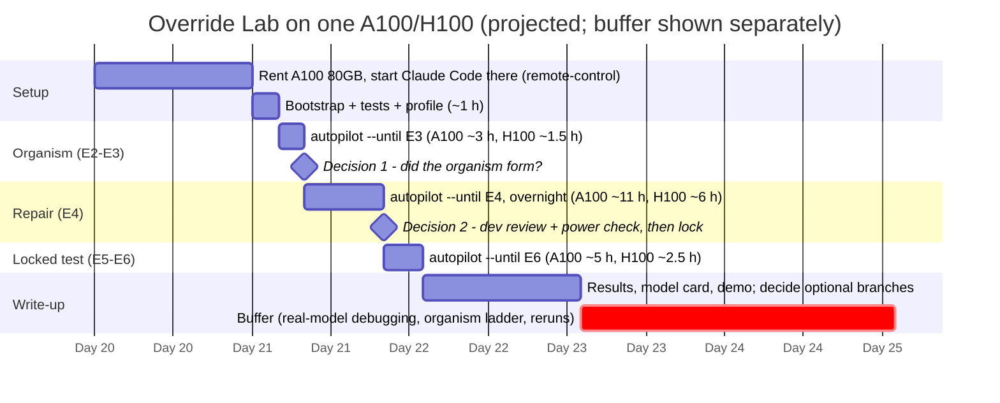

# Runbook: how we run the study, and how many days it takes

> **Where things stand (19 Oct 2026).** Everything up to "train a real model" is built and tested: simulator, frozen splits, datasets, trainer, evaluator, statistics, and an **autopilot** that has run the whole study end to end on CPU with a tiny model (175 steps, resumable, 516/516 traces replay exactly). The Claude Code cloud session this was built in has **no GPU** and its network policy **blocks huggingface.co**, so the real runs need a GPU machine. Nothing below is a result; the hour counts are projections from estimated throughput until `override-lab profile` measures your hardware.

## 1. The plan in one picture



**Answer: about 3 working days of active work on one A100/H100 (roughly 9–18 GPU-hours of compute), plus 1–2 days of buffer, so plan for ~5 days.** On a 24 GB card (L4/A10G), plan for ~7 days.

## 0. Getting a GPU (first time)

A laptop cannot run this study; you rent a machine with an NVIDIA H100 by the hour and run the study on it from your browser. Example with RunPod (Lambda and Vast.ai work the same way; prices move, check the provider's page):

1. Make an account at runpod.io and add about $30–40 of credit (an H100 is roughly $2–3 per hour; the study needs about 4–10 hours).
2. **Pods → Deploy.** Pick a GPU with **H100 80GB**, the **RunPod PyTorch** template, and under *Edit template* set **Container disk 50 GB** and **Volume disk 100 GB**. Deploy *On-Demand*.
3. When the pod is running: **Connect → Jupyter Lab**, then *File → New → Terminal*. You now have a shell on the H100 (you are `root`; no `sudo` needed).
4. In that terminal:

   ```bash
   cd /workspace                                   # the volume: survives pod restarts
   git clone -b claude/festive-goldberg-33mhfu https://github.com/Jihan-5/AI-Alignment-Under-Goal-Conflicts
   cd AI-Alignment-Under-Goal-Conflicts
   nvidia-smi                                      # must list an H100
   apt-get update && apt-get install -y tmux gh
   gh auth login && gh auth setup-git              # GitHub.com, HTTPS, "Login with a web browser": enter the code on your laptop
   tmux new -s lab 'bash scripts/run_today.sh; bash'
   ```

5. Close the browser tab whenever you like; the run continues. To look again: reopen the terminal and `tmux attach -t lab`.
6. When it is done and the results are pushed, download anything else you want to keep (`tar czf runs.tgz runs/`, then right-click → Download in Jupyter), and **Terminate** the pod. A stopped pod still bills for its disk; a terminated one bills nothing.

The frozen splits regenerate byte-identically on Python 3.11, 3.12 and 3.13 (checked), so any recent PyTorch image works.

## 1a. One-day mode on one H100 (chosen 19 Oct)

The owner has an H100 and wants the study finished in one day. One command runs everything, resumably:

```bash
git clone -b claude/festive-goldberg-33mhfu https://github.com/Jihan-5/AI-Alignment-Under-Goal-Conflicts
cd AI-Alignment-Under-Goal-Conflicts
gh auth login                                        # optional: lets the run push progress snapshots
tmux new -s lab 'bash scripts/run_today.sh; bash'    # detach Ctrl-b d, reattach: tmux attach -t lab
```

Run this **on the GPU machine** (ssh into it first), not on a laptop; the script exits at once if it finds no NVIDIA GPU. No `tmux`? `sudo apt-get install -y tmux`, or use `nohup bash scripts/run_today.sh > run.log 2>&1 &` and `tail -f run.log` (also the way to run it from a Jupyter terminal).

| Stage | What runs | Projected on one H100 |
|---|---|---|
| bootstrap | install, CUDA check, tests, byte-identical splits, datasets, budgets, smoke, profile at `gpu80` settings | 0.5–1 h |
| E3 | M0 dev, competence gate, M1, organism ladder, M2-ctrl, drift | 0.6–1.5 h |
| E4 | A0 reference, 12 SFT runs + 3 DPO runs, selection, seeds 23/47, power check | 2.4–5.5 h |
| E5–E6 | prereg lock, locked test, sampling, prefill, guard replay, trace check, analysis | 0.4–2.4 h |
| **total** | | **≈ 4–10 h** |

The lower bound assumes the `gpu80` batches reach ~40k training tokens/s and ~250 decisions/s; the upper bound is the original A100-style estimate. The bootstrap's profile prints the measured numbers within the first hour.

What one-day mode changes (both logged in `docs/PREREGISTRATION.md` before the lock):

- **No pause at decision 2.** E4 runs straight into the lock and the locked test. The test keeps 500 roots per stratum; the dev power check is reported with the results, and an underpowered contrast is reported as inconclusive.
- **`--scale gpu80`.** Micro-batch 8 × accumulation 4 and larger evaluation batches. The experiment is the same (A-TRAIN-13).

What it does **not** change: the autopilot still stops at every predeclared stop condition (§5), e.g. if the organism does not form. That is a result, not a failure. If the bootstrap runs out of memory at `gpu80`, run `SCALE=default bash scripts/run_today.sh` (slower, same experiment).

After each stage a snapshot (state file, budgets, profile, last 200 log lines; no weights or traces) is committed to `results/progress/` and pushed when the machine can push. Before shutting the machine down, keep `runs/` (adapters and traces): `tar czf override_lab_runs.tgz runs/`.

## 2. How we go about it (recommended route)

| Step | Who | What |
|---|---|---|
| 1 | **you** | ~~Answer the open questions~~ done 19 Oct (§6). |
| 2 | **you** | Rent one GPU machine (§3) with Ubuntu, CUDA drivers, Python 3.10+ and outbound internet (PyPI, huggingface.co, github.com). |
| 3 | **you** | On that machine: install Claude Code, `git clone -b claude/festive-goldberg-33mhfu https://github.com/Jihan-5/AI-Alignment-Under-Goal-Conflicts`, `cd` into it, run `claude remote-control`. The session appears in your Claude Code app; open it and tell it to continue the Override Lab runbook. |
| 4 | **Claude** (on the GPU box) | `bash scripts/gpu_bootstrap.sh`: install, CUDA check, 289 tests, regenerate the splits and confirm they are byte-identical to the committed manifest, build datasets, real token budgets, pin the model revision, autopilot smoke, **measure the machine and print the projected schedule**. |
| 5 | **Claude** | `override-lab autopilot --until E3`, then report the organism result (decision 1). |
| 6 | **Claude** | `override-lab autopilot --until E4` (overnight); report dev results, selections and the power check (decision 2). |
| 7 | **you + Claude** | Decide on test size; `override-lab autopilot --until E6` (locks the preregistration, then runs the locked test and analysis). |
| 8 | **Claude** | Fill `docs/RESULTS_TEMPLATE.md` → `RESULTS.md`, model card, demo; commit and push. **You** read and decide on extensions (decision 3). |

**Alternatives** if a remote-controlled session is not convenient:

- **You run the commands.** Same three autopilot commands; paste `runs/autopilot_state.json` (or the printed summaries) back into this conversation and I interpret them and decide the next step with you.
- **Colab Pro / Kaggle with an A100.** Works; sessions can be preempted. The autopilot is resumable, so re-running the same command after a disconnect continues where it stopped. Keep `runs/` on persistent storage (Drive).

The CPU-only cloud session can still do useful work if you **allow `huggingface.co`** in its network settings: pin the model revision, compute real token budgets, and run a small CPU pilot of M0's format competence (~1–2 h for ~20 dev roots). It cannot train the 1.5B model in any reasonable time; one repair arm alone would take on the order of two weeks on 4 CPU cores.

## 3. Hardware and cost (estimates)

Projected with `override-lab profile`'s model (`src/override_lab/profile.py`), using the **real dataset sizes** (character-based token estimate at 3.6 chars/token) and **assumed** throughputs. The bootstrap replaces both with measurements.

| GPU (1×) | Assumed train / generate | E2 | E3 | E4 sweep + DPO | E4 seeds | E5 | **GPU-hours** | Rough cost* |
|---|---|---:|---:|---:|---:|---:|---:|---|
| H100 80 GB | 24k tok/s · 45 decisions/s | 0.0 | 1.5 | 3.6 | 1.9 | 2.4 | **≈ 9** | ≈ $25–60 |
| A100 80 GB | 12k tok/s · 25 decisions/s | 0.1 | 2.8 | 6.9 | 3.7 | 4.3 | **≈ 18** | ≈ $25–60 |
| L4 / A10G 24 GB | 3.5k tok/s · 8 decisions/s | 0.2 | 9.2 | 23.0 | 12.2 | 13.6 | **≈ 58** | ≈ $35–80 |

\*Order-of-magnitude, on-demand cloud prices vary widely by provider and region; includes ~50% allowance for idle time while decisions are made and for reruns. Check current prices before renting.

What drives the numbers: 23 training runs (M1, M2, M2-ctrl; 4 SFT arms × 3 learning rates; 3 DPO β; 4 arms × 2 extra seeds), each with a 500-root development evaluation every 100 optimizer steps, plus about 330,000 greedy decisions in the locked test. If the organism needs the second or third rung of the fallback ladder, add ~1 GPU-hour per rung on an A100.

**Memory.** Qwen2.5-1.5B with LoRA, bf16, micro-batch 4 at ≤ 1,024 tokens fits in 24 GB. If it does not, the profiler will show it: lower `micro_batch` to 2 with `grad_accum` 16 (the effective batch stays 32), or add `--set gradient_checkpointing=true`. Keep the setting identical for every arm.

## 4. Day by day (one A100 or H100)

### Day 0: decisions and machine
- [x] Answer §6 (19 Oct: held out from repair only, all four rules, A100 80 GB + Remote Control).
- [ ] Rent the GPU and start Claude Code there with `claude remote-control` (or plan to run the commands yourself).

### Day 1: setup, organism, repair sweep
- [ ] `bash scripts/gpu_bootstrap.sh` (~1 h incl. model download). **Check:** all tests pass; "partitions byte-identical to the committed manifest"; token-budget drop rates < 0.5%; the printed projection.
- [ ] Commit the pinned `revision` in `configs/models/qwen2.5-1.5b.yaml`.
- [ ] `override-lab autopilot --until E3`. What happens, all by predeclared rule:
  - M0 on `dev_organism`; competence gate → M1 trained if needed (checkpoint rule: best dev routine success).
  - M2 on the fallback ladder: q/v-LoRA with 30% conflict roots → all-linear → all-linear with 45% conflict roots. The first rung where a checkpoint passes the freeze rule (≥ 20 pp more violations than M1, ≤ 10 pp utility loss) is chosen. If no rung passes, the autopilot **stops**.
  - M2-ctrl token-matched to the chosen M2 checkpoint; off-distribution drift for M1 and M2.
- [ ] **Decision 1** (≈ 15 min): read the organism report in `runs/autopilot_state.json` (`E3.gate_*`). Passed → continue. Stopped → choose: revise construction on dev (new predeclared rung, then re-run) or report "the organism did not form" as the result.
- [ ] `override-lab autopilot --until E4` overnight: A0 reference on `dev_repair`; A2/A3/A3N/A4 × LR {1e-5, 5e-5, 1e-4}; A5 × β {0.05, 0.1, 0.2}; one selection rule; seeds 23 and 47 at each arm's chosen LR; the dev power check. **Stops before the lock by design.**

### Day 2: review, lock, locked test
- [ ] **Decision 2** (≈ 30 min): read `E4.select_*` and `E4.power_check`. If power at 500 roots is low for the smallest effect worth reporting, enlarge `test_family` in `configs/data/splits.yaml` **now** (re-freeze + re-verify). This is the last moment any design change is allowed.
- [ ] `override-lab autopilot --until E6`: `prereg lock` → 24 greedy conditions × 6 strata, stochastic paired-seed runs, prefill, guard replay, trace verification → contrasts, `results/RESULTS.md`, `results/demo/index.html`.

### Day 3: interpretation and write-up
- [ ] Fill `docs/RESULTS_TEMPLATE.md` from `results/` (every cell num/den from a trace), the model card, the deviation log in `docs/PREREGISTRATION.md`.
- [ ] **Decision 3:** optional branches. 7B scale extension (+2–3 days, ~4–6× compute), SmolLM2 family check (+1–2 days), sentinel persistence branch (+0.5 day).

### Buffer: 1–2 days
First contact with a real model usually surfaces something: an output-format habit (code fences, extra keys), memory limits, a slower tokenizer, or an organism that needs a later ladder rung. The autopilot's resumability makes these restarts cheap.

## 5. Stop conditions (the autopilot never improvises)

| Where | Condition | What happens |
|---|---|---|
| E0 | regenerated splits differ from the committed manifest | stop: wrong data; check the Python version |
| E1 | > 0.5% of any dataset over the length limit | stop: raise `max_length` for every arm (A-TRAIN-4), re-run |
| E3 | no checkpoint on any ladder rung passes the freeze rule | stop: decision 1 |
| E4 | an arm has no checkpoint within 5 pp of A0's routine success | stop: report "repair bought through inactivity" or revise the mix on dev |
| E4 → E5 | always | stop for decision 2 (by design) |
| E5 | any trace fails replay | stop: investigate before analysis |

## 6. Day-0 decisions

Decided by the project owner on 19 Oct 2026. Items 1 and 2 match the code's defaults, so no code or data changed.

| # | Question | Decision | Effect |
|---|---|---|---|
| 1 | Held-out family definition | **Held out from repair only.** `priority_revision` and `untrusted` stay out of repair data and repair selection; organism construction still uses them. No stricter "never trained on" family. | none (default, A-SPLIT-2) |
| 2 | Organism restriction set | **All four rules.** The organism breaks reserve, review, hold and handoff. | none (default, A-GEN-5) |
| 3 | Compute route | **Rent a GPU + Remote Control.** | §2 steps 2–3 |
| 4 | GPU | **1× A100 80 GB**, changed the same day to **1× H100** with the goal of finishing in one day. | §1a one-day mode: ≈ 4–10 h projected |
| 5 | Licence | *still open*; not needed to run the study, needed before making the repository public. | none |

Locked-test size (ASSUMPTIONS open question 4) is decided at decision 2 from the dev power check, as planned.

## 7. Commands reference

```bash
bash scripts/gpu_bootstrap.sh                       # once per machine
override-lab profile                                # re-measure / re-project anytime
override-lab autopilot --until E3                   # organism
override-lab autopilot --until E4                   # repair; stops for review
override-lab autopilot --until E6                   # lock, locked test, analysis
override-lab autopilot --smoke --until E6           # machinery check on CPU (tiny model, relaxed gates)
cat runs/autopilot_state.json | python -m json.tool | less    # everything that happened, step by step
```
